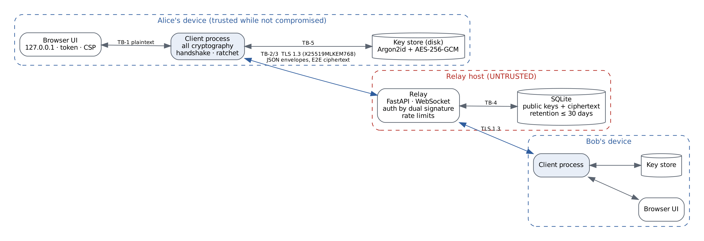

# PQ-Chat

An end-to-end encrypted messenger designed to stay secure against a future quantum computer.
It combines **X25519 with ML-KEM-768** (FIPS 203) in a PQXDH-style hybrid handshake, signs every key
with **both Ed25519 and ML-DSA-65** (FIPS 204), and protects ongoing chats with a **double ratchet plus
periodic ML-KEM re-keying**. The relay server is untrusted: it only ever sees public keys and ciphertext.

MS Cybersecurity capstone project. Project brief: [`CLAUDE.md`](CLAUDE.md) ·
progress log: [`docs/PROGRESS.md`](docs/PROGRESS.md).



## Results at a glance

| Question | Answer | Evidence |
|---|---|---|
| Is a session secret if **either** X25519 **or** ML-KEM is broken? | Yes — proved for unbounded sessions | [`formal/RESULTS.md`](formal/RESULTS.md) (ProVerif 2.05) |
| Does classical mode survive "harvest now, decrypt later"? | No — attack found; hybrid mode: proved secure | same |
| Does the session heal after a device theft, even against a quantum attacker? | Yes, after the next ML-KEM re-key (K/2 round trips; 2 with the default K = 4) | `tests/unit/test_ratchet_pcs.py`, `formal/ratchet_bounded.pv` |
| What does post-quantum security cost? | ≈ 0.3 ms more per handshake, but 21 KB bundles and ≈ 1.5 KB average messages at K = 4 | [`docs/notes/m11-benchmarks.md`](docs/notes/m11-benchmarks.md) |
| What does a seized relay database reveal? | Usernames and who-messages-whom; no plaintext, no private keys, no deleted ciphertext | [`docs/forensics.md`](docs/forensics.md) |
| What did the penetration test find? | 10 findings; all fixable ones fixed and retested; 2 design limits accepted | [`docs/pentest-report.md`](docs/pentest-report.md) |

## 1. Run the demo (Docker, about 5 minutes)

Needs Docker with the Compose plugin. On Windows use Docker Desktop with WSL2.

```bash
git clone https://github.com/Asad3404/PQChat.git
```

```bash
cd PQChat
```

```bash
scripts/demo.sh
```

The script builds the images (compiling liboqs 0.16.0 from source the first time), starts a relay
that speaks TLS 1.3 only and two clients, and prints two links like
`http://127.0.0.1:8701/#token=…`. Open each in its own browser window, create the identities
`alice` and `bob`, chat, and compare the safety numbers in the (i) panel.

Stop the demo and delete its data:

```bash
scripts/demo.sh --down
```

The same steps by hand: `docker compose up --build -d`, then
`docker compose logs alice bob | grep "PQ-Chat UI"` for the links.

**Demo video.** With the demo running, record both browsers and assemble a captioned walkthrough
(needs Node + Playwright and ffmpeg):

```bash
node scripts/record_demo.mjs "<alice link>" "<bob link>" demo-out
```

```bash
.venv/bin/python scripts/make_demo_video.py demo-out demo-out/relay_view.txt evidence/demo/pqchat-demo.mp4
```

Before the second command, save the relay's view for the "what the relay stores" card (the
arguments are texts from the chat, shown to be absent from the database):

```bash
scripts/relay_view.sh "post-quantum message" "brand-new key" > demo-out/relay_view.txt
```

## 2. Development setup (Linux or WSL2)

Ubuntu 24.04 packages:

```bash
sudo apt-get install -y python3.12 python3.12-venv build-essential cmake ninja-build libssl-dev git
```

Build liboqs 0.16.0 from source (the script checks the release's commit hash):

```bash
sudo scripts/install_liboqs.sh
```

Without root, install into the repository and point liboqs-python at it:

```bash
scripts/install_liboqs.sh "$PWD/.liboqs" && export OQS_INSTALL_PATH="$PWD/.liboqs"
```

Python environment with every pinned dependency:

```bash
python3.12 -m venv .venv
```

```bash
.venv/bin/pip install -c requirements/constraints.txt -e '.[dev,bench]'
```

Check the post-quantum library:

```bash
.venv/bin/python -m pqchat.selftest
```

Expected output: `liboqs 0.16.0: ML-KEM-768 OK, ML-DSA-65 OK`.

## 3. Run the checks

All tests (≈ 15 s; includes vectors, property tests, a real relay, the 1,000-message test):

```bash
.venv/bin/pytest --cov=pqchat
```

Lint, types and security scanners:

```bash
.venv/bin/pre-commit run --all-files
```

```bash
.venv/bin/pip-audit --strict -r requirements/constraints.txt
```

Semgrep lives in its own virtualenv:

```bash
python3.12 -m venv .semgrep-venv && .semgrep-venv/bin/pip install semgrep==1.183.0
```

```bash
.semgrep-venv/bin/semgrep scan --error --metrics=off --config .semgrep/pqchat-rules.yml --config p/python --config p/security-audit src tests
```

## 4. Reproduce the research results

| What | Command | Output |
|---|---|---|
| Formal proofs (needs `opam install proverif`, ≈ 30 min; `--quick` ≈ 15 min) | `formal/run.sh` | table compared with expected results |
| Benchmarks, 1,000 runs per mode (≈ 10 s) | `.venv/bin/python bench/run_bench.py --runs 1000` | `bench/results/*.csv`, `*.png` |
| Attack suite | see [`attacks/README.md`](attacks/README.md) | `evidence/m8/` |
| Forensic search | `.venv/bin/python forensics/image_and_search.py --demo` | `evidence/m9/case/report.json` |
| Figures | `.venv/bin/python scripts/make_figures.py` (needs Graphviz) | `docs/figures/` |
| Cryptographic bill of materials | `.venv/bin/python scripts/make_cbom.py` | `docs/cbom.json` |
| Browser end-to-end test | `scripts/demo.sh --e2e` (needs Node + Playwright) | `evidence/m6/*.png` |

## 5. Documentation

| Topic | Document |
|---|---|
| Threat model, risk register, 37 security requirements with evidence | [`docs/threat-model.md`](docs/threat-model.md) |
| Protocol specification (byte level) | [`docs/protocol-spec.md`](docs/protocol-spec.md) |
| Design notes per milestone | [`docs/notes/`](docs/notes/) |
| Architecture decisions | [`docs/decisions/`](docs/decisions/) (ADR-001 liboqs build, ADR-002 approved protocol changes, ADR-003 first ratchet message) |
| ProVerif results | [`formal/RESULTS.md`](formal/RESULTS.md) |
| OWASP ASVS 5.0 Level 2 checklist | [`docs/asvs-checklist.md`](docs/asvs-checklist.md) |
| Network hardening and metadata analysis | [`docs/notes/m7-network.md`](docs/notes/m7-network.md) |
| Penetration test (CVSS v4.0) | [`docs/pentest-report.md`](docs/pentest-report.md) |
| Forensics and incident-response playbook | [`docs/forensics.md`](docs/forensics.md) |
| NIST IR 8547, CSF 2.0, data minimisation | [`docs/compliance.md`](docs/compliance.md), [`docs/cbom.json`](docs/cbom.json) |
| Benchmarks | [`docs/notes/m11-benchmarks.md`](docs/notes/m11-benchmarks.md) |
| Thesis notes and viva preparation | [`docs/thesis-notes/`](docs/thesis-notes/) |

## 6. Repository layout

```
src/pqchat/crypto/     thin wrappers: ML-KEM, ML-DSA, X25519, Ed25519, HKDF/HMAC, AES-GCM, key store
src/pqchat/protocol/   encoding, bundles, hybrid handshake, double ratchet + ML-KEM re-key, padding
src/pqchat/server/     untrusted relay (FastAPI, WebSocket, SQLite), rate limits, TLS 1.3
src/pqchat/client/     encrypted key store, relay client, local web UI (static/)
tests/                 unit, property (Hypothesis), vectors (RFC + NIST ACVP), negative, integration
formal/                ProVerif models and run script
attacks/  forensics/  bench/  scripts/  evidence/  docs/
```

## 7. Limitations (details in the documents above)

* First-contact identity substitution by a malicious relay is only detectable by comparing safety
  numbers (as in Signal); initiator authentication relies on X25519 (pentest F-01, F-02).
* The relay sees who talks to whom and when (no sealed sender).
* The PQ ratchet is a simplification of Signal's SPQR: whole ML-KEM keys and ciphertexts instead of
  the erasure-coded braid.
* Research prototype: libraries are not FIPS-validated; Python cannot guarantee secrets are erased
  from memory; one device per user; no group chats.

Built with AI assistance (Claude Code); see the project brief for the working method.
