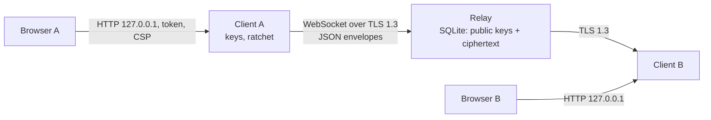

# Design note — Milestone 6: relay server, client key store and local web UI

**Status:** implemented (review after M12). "Done when": two users chat in the browser via Docker
Compose (✅ `scripts/e2e_browser.mjs`, screenshots in `evidence/m6/`); ASVS checklist filled in
(✅ `docs/asvs-checklist.md`).

## Architecture

## Decisions

| # | Decision | Why |
|---|---|---|
| D1 | One WebSocket endpoint with JSON envelopes (`pqchat/wire.py`), shared schema for client and relay | PROJECT-BRIEF.md §5.5; one strict parser to test and fuzz (M8) |
| D2 | Relay login = signature with **both** identity keys over `(purpose, username, fresh nonce)` under label `SIG_RELAY_AUTH` | No passwords on an untrusted server; post-quantum authentication; nonce prevents replay (SR-21) |
| D3 | A username is bound to the identity that registered it first | Prevents squatting/hijack of an existing name (T-18) |
| D4 | Relay re-verifies uploaded prekeys (both signatures, expiry) | Stops the relay from being used to distribute junk; clients still verify everything themselves |
| D5 | One-time prekeys are deleted by the relay in the same transaction that hands them out | SR-10 at the relay side; prevents double use even under concurrency |
| D6 | Messages deleted on `ack` by their recipient only, and after 30 days at most; `PRAGMA secure_delete` | SR-20, minimises what a seized relay database contains (M9) |
| D7 | Client state = one JSON document (keys, prekeys, sessions, contacts, history), encrypted with Argon2id + AES-256-GCM, written atomically with mode 0600 | SR-26, SR-27; no pickle; crash-safe |
| D8 | Contacts pinned on first use (TOFU); a different identity blocks sending until the user accepts | SR-17 (T-02); UI shows a red bar and the new safety number |
| D9 | Alice's first double-ratchet message travels **inside** the handshake | Bob can reply at once. *Found by looking at the M6 screenshot:* without it, Bob's first reply silently started a second handshake and consumed one of Alice's one-time prekeys. |
| D10 | UI token delivered in the URL **fragment**; Host allow-list; Origin check; strict CSP | SR-28/29 (T-29 – T-31) |
| D11 | Undecryptable or untrusted messages are dropped and counted, never displayed, and still acknowledged | Forged traffic cannot clutter the UI or fill the relay queue |

## Known limitations

* If both users start a chat at the same moment, the later initial message replaces the earlier session (no session merging, as Signal does). Messages are not lost, only re-keyed.
* One device per user (multi-device is out of scope).
* The UI polls the local client every 1.5 s; acceptable for a demo.
* Playwright (used only by `scripts/e2e_browser.mjs`) is a test tool and not in §6: see "decisions needed".
