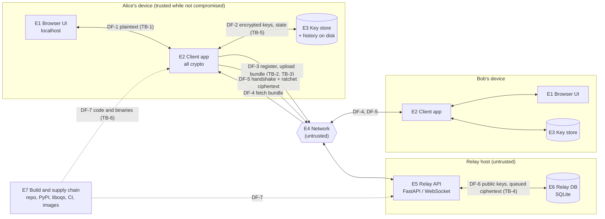

# PQ-Chat threat model

**Version:** 1.0 (Milestone 1) · **Date:** 2026-11-04 · **Status:** awaiting approval
**Method:** assets → data-flow diagram → attackers → STRIDE-per-element → 5 × 5 risk register →
security requirements, with machine-checked traceability (`tests/unit/test_threat_model_traceability.py`).
See the design note [`docs/notes/m1-threat-model.md`](notes/m1-threat-model.md) for why these methods were chosen.

ID scheme: assets `AS-n` · assumptions `ASM-n` · elements `E1–E7` · data flows `DF-n` ·
trust boundaries `TB-n` · attackers `A1–A4` · goals `G-n` · threats `T-nn` · requirements `SR-n`.

---

## 1. System overview

PQ-Chat has three kinds of component:

* **Client** (one per user, on the user's own device): a Python process that holds all keys,
  runs all cryptography, and serves a local web UI to the user's browser on `127.0.0.1`.
* **Relay**: a FastAPI server that stores prekey bundles and forwards encrypted messages.
  It is **untrusted**: the design must stay secure even if it is fully malicious.
* **Build and supply chain**: source repository, dependencies, liboqs, CI and Docker images.

## 2. Assets

<!-- table:assets -->
| ID | Asset | Property needed | Where it lives |
|---|---|---|---|
| AS-1 | Message plaintext | Confidentiality, integrity | E1, E2 (memory); E3 if history is kept |
| AS-2 | Long-term identity private keys (IKsig-ed, IKsig-pq, IKdh) | Confidentiality | E3 (encrypted), E2 (memory) |
| AS-3 | Prekey private keys (SPK, PQSPK, OPK, PQOPK) | Confidentiality; one-time keys must be used once | E3, E2 |
| AS-4 | Session state (root key, chain keys, skipped message keys, KEM ratchet keys) | Confidentiality, integrity | E3, E2 |
| AS-5 | Key-store passphrase | Confidentiality | User's memory; E2 briefly |
| AS-6 | Public identity keys and signed prekey bundles | Integrity, authenticity | E5, E6, E4 |
| AS-7 | Metadata: who talks to whom, when, how much | Confidentiality (minimise) | E4, E5, E6, logs |
| AS-8 | Relay availability and one-time-prekey supply | Availability | E5, E6 |
| AS-9 | Build artefacts and dependencies | Integrity | E7 |

## 3. Assumptions

| ID | Assumption |
|---|---|
| ASM-1 | At least one of X25519 (CDH) or ML-KEM-768 (MLWE) is secure; SHA-256/HKDF/HMAC and AES-256-GCM are secure, also against a quantum attacker (Grover only halves the security level of AES-256, which leaves 128 bits). |
| ASM-2 | liboqs 0.16.0 and pyca/cryptography implement their algorithms correctly (we test vectors, but do not audit their C code). |
| ASM-3 | The OS random number generator (`os.urandom`) is secure. |
| ASM-4 | The endpoint is not running malware with live memory access while it is in use (out of scope, CLAUDE.md §4). |
| ASM-5 | Users choose a key-store passphrase of reasonable strength. |
| ASM-6 | Device clocks are correct to within about a day (only needed for prekey expiry, SR-18). |
| ASM-7 | Users who want protection against a malicious relay on first contact compare safety numbers out-of-band (SR-17). |

**Out of scope** (CLAUDE.md §4): malware with live memory access on the endpoint, anonymity against
global traffic analysis, multi-device sync, group chats. Physical side channels (power, EM) are also out of scope.

## 4. Data-flow diagram

### Data flows

| ID | From → to | Content | Crosses |
|---|---|---|---|
| DF-1 | E1 ↔ E2 | Plaintext messages, contact names, UI commands (HTTP on 127.0.0.1) | TB-1 |
| DF-2 | E2 ↔ E3 | Encrypted private keys, session state, message history | TB-5 |
| DF-3 | E2 → E5 | Registration, signed prekey bundle upload (public keys + signatures) | TB-2, TB-3 |
| DF-4 | E5 → E2 | Prekey bundle download | TB-3, TB-2 |
| DF-5 | E2 → E5 → E2 | Initial handshake message and ratchet messages (headers + AEAD ciphertext) | TB-2, TB-3 |
| DF-6 | E5 ↔ E6 | Accounts, public keys, queued ciphertext | TB-4 |
| DF-7 | E7 → E2, E5 | Source code, Python packages, liboqs, container images | TB-6 |

### Trust boundaries

| ID | Boundary | Why it matters |
|---|---|---|
| TB-1 | Browser ↔ client process | Any website open in the same browser, and any local user, can send requests to `127.0.0.1`. |
| TB-2 | Device ↔ network | Everything on the wire is visible to and modifiable by A1. |
| TB-3 | Network ↔ relay | Input from anyone on the internet reaches the relay parser. |
| TB-4 | Relay process ↔ its storage and operator | Whatever the relay stores can be read by A2 and by anyone who images the server later (M9). |
| TB-5 | Running client ↔ data at rest | A stolen device or key-store file (A3) exposes only what is on disk. |
| TB-6 | Third-party code ↔ our build | Dependencies, liboqs and CI actions execute with our privileges. |

## 5. Attackers

| ID | Attacker | Can | Cannot (by assumption) | Main goals threatened | How it is modelled in M4 / tested in M8 |
|---|---|---|---|---|---|
| A1 | **Network attacker (Dolev-Yao).** Includes a malicious registered user and any website in the victim's browser. | Read, modify, drop, delay, replay and inject any message; register accounts; send crafted input to any parser or endpoint. | Break the cryptographic primitives (ASM-1); read endpoint memory. | Confidentiality, authentication, replay and downgrade resistance, availability | ProVerif public channel `c`; mitmproxy addon, replay/downgrade scripts, fuzzers |
| A2 | **Malicious relay.** | Everything A1 can do, plus: choose which bundles and identity keys to serve, keep all data forever, withhold or reorder messages, see full metadata. | Read anything not sent to it; break primitives. | Authentication (key substitution), metadata, availability, HNDL storage | Relay is just another process on the attacker-controlled channel; mitmproxy prekey/identity swap |
| A3 | **Device compromise** at a point in time. | Obtain the key-store file (offline guessing of the passphrase), or the full in-memory state at time *t*. | Keep live access afterwards (that would be malware, out of scope). | Forward secrecy, post-compromise security, data at rest | ProVerif `phase` + key-leak events; `attacks/key_compromise_demo.py`; M9 forensics |
| A4 | **Harvest-now-decrypt-later quantum attacker.** Also its *active future* variant, which can forge Ed25519 signatures for sessions started after a quantum computer exists. | Record all traffic today; later solve discrete logs (break X25519 and Ed25519). | Break ML-KEM-768, ML-DSA-65, SHA-2 or AES-256. | Confidentiality of past traffic; authentication of future sessions | ProVerif: X25519/Ed25519 private keys released in a later phase; `classical` mode must fail, `hybrid` must hold |

## 6. Security goals

<!-- table:goals -->
| ID | Goal | Requirements |
|---|---|---|
| G-1 | Confidentiality of message content | SR-4, SR-7, SR-19, SR-23, SR-27, SR-29 |
| G-2 | Mutual authentication of the two users | SR-5, SR-17, SR-21, SR-36, SR-37 |
| G-3 | Forward secrecy | SR-10, SR-12, SR-13, SR-15 |
| G-4 | Post-compromise security | SR-14 |
| G-5 | Hybrid security (safe if either X25519 or ML-KEM holds) | SR-4, SR-5, SR-14 |
| G-6 | Replay resistance | SR-11, SR-12 |
| G-7 | Downgrade resistance | SR-6 |
| G-8 | Minimal metadata | SR-20, SR-24, SR-25 |
| G-9 | No plaintext or private keys at rest on the server | SR-19, SR-20 |

## 7. Threats (STRIDE per element)

STRIDE: **S**poofing, **T**ampering, **R**epudiation, **I**nformation disclosure, **D**enial of service, **E**levation of privilege.

<!-- table:threats -->
| ID | Element | STRIDE | Attacker | Threat |
|---|---|---|---|---|
| T-01 | E4 Network / DF-4 | S | A1, A2 | Attacker replaces Bob's signed prekeys (SPK, PQSPK, OPK, PQOPK) in the bundle with its own keys, so Alice's handshake runs with the attacker. |
| T-02 | E5 Relay / DF-4 | S | A2 | Relay serves a fake *identity* (its own IKsig/IKdh keys under Bob's name) on first contact; the prekey signatures then verify under the fake identity and the relay sits in the middle. |
| T-03 | E4 Network / DF-5 | I | A4 | Harvest now, decrypt later: traffic recorded today is decrypted once X25519 can be broken. |
| T-04 | DF-4, DF-5 | T | A1, A2, A4 | Downgrade: PQ prekeys are stripped from the bundle, or the mode byte is changed to `classical`, so the session has no ML-KEM component and falls to T-03. |
| T-05 | DF-5 | T | A1 | Header fields of the initial message (EK_A, CT, prekey IDs, algorithm IDs, identity keys) are modified in transit. |
| T-06 | DF-5 | T | A1, A2 | The initial handshake message is replayed to Bob, making him re-derive the session or accept the first message twice. |
| T-07 | DF-5 | T | A1, A2 | Ratchet messages are replayed, reordered or dropped to cause duplicates, desynchronisation or unbounded state. |
| T-08 | DF-4 | S | A4 | Active future quantum attacker forges Ed25519 signatures on a fake prekey bundle. |
| T-09 | E2 Client protocol | S, T | A1 | Key/encoding confusion or unknown-key-share: an ambiguous encoding, a KEM re-encapsulation trick or missing key binding makes the two parties agree on a key while disagreeing about who or what they used (cf. Bhargavan et al. 2024 on PQXDH). |
| T-10 | E2 Client, E5 Relay parsers | D, E | A1, A2 | Malformed, truncated or oversized input crashes a parser, exhausts memory or reaches crypto code with unchecked lengths. |
| T-11 | E4 Network | I | A1 | Passive observer learns who connects to the relay, when, and how much data is sent. |
| T-12 | DF-5 | I | A1, A2 | Ciphertext length reveals plaintext length and therefore hints at content. |
| T-13 | E6 Relay DB | I | A2 | Relay operator (or a later image of the server) reads stored data looking for plaintext or private keys. |
| T-14 | E6 Relay DB | I | A2, A4 | Relay keeps ciphertext indefinitely, which maximises what a future quantum attacker can attempt to decrypt. |
| T-15 | E5 Relay, logs | I | A2 | Relay learns the social graph: which accounts message which, and when. |
| T-16 | E5 / E6 prekey store | D | A1, A2 | Prekey exhaustion: an attacker fetches Bob's bundles until no one-time prekeys remain, so new sessions fall back to the reusable last-resort prekeys (weaker forward secrecy for first messages). |
| T-17 | E5 Relay | D | A1 | Flooding: many connections, large messages or many bundle uploads that force ML-DSA verifications exhaust relay resources. |
| T-18 | E5 Relay API | S | A1 | Attacker impersonates a user towards the relay: registers their name first, uploads bundles for them, or reads and deletes their message queue. |
| T-19 | E5 Relay | D | A2 | Relay silently drops or withholds selected messages. |
| T-20 | E2 Client, `pq-only` mode | R | A1, A2 | In `pq-only` mode Alice signs the transcript, which creates transferable proof that she communicated with Bob (loss of deniability). |
| T-21 | E5 Relay host | E | A1 | Remote code execution or SQL injection in the relay through a code bug or a vulnerable dependency. |
| T-22 | E2, E5 logs | I | A2, A3 | Private keys, shared secrets, plaintext or full ciphertexts end up in log files. |
| T-23 | E3 Key store | I | A3 | Stolen key-store file is brute-forced offline to recover identity and prekey private keys. |
| T-24 | E2, E3 session state | I | A3 | Attacker who obtains the current session state decrypts *earlier* messages. |
| T-25 | E2, E3 session state | S, I | A3, A4 | Attacker who obtained session state keeps decrypting or forging *future* messages; with a quantum computer it can follow every DH ratchet step. |
| T-26 | E3 history | I | A3 | Message history stored in plaintext on disk is read from a stolen device. |
| T-27 | E2 memory, swap, core dumps | I | A3 | Secrets remain in Python memory, swap or core dumps after use because Python cannot reliably erase memory. |
| T-28 | E2 Client | I | A1 | Timing side channels in Python code that handles secrets. |
| T-29 | E1 / TB-1 | S, E | A1 | A malicious website open in the user's browser sends requests to the local client (CSRF or DNS rebinding) to read history or send messages. |
| T-30 | E1 Browser UI | E, I | A1 | A peer sends a message or display name containing HTML/JavaScript (XSS) that runs in the local UI and exfiltrates plaintext. |
| T-31 | E1 / TB-1 | S | A1 | Another user on the same machine connects to the client's localhost port. |
| T-32 | E7 dependencies | T | A1 | A compromised or vulnerable dependency, or liboqs-python silently downloading an unpinned liboqs. |
| T-33 | E7 CI | T, E | A1 | A malicious pull request or a hijacked third-party GitHub Action tampers with builds or steals CI secrets. |
| T-34 | DF-4 bundle | S | A2 | Relay serves an *old* but validly signed prekey whose private key the attacker obtained earlier (prekey rollback). |
| T-35 | E2 key generation | I | A1 | Keys or nonces come from a non-cryptographic random source and can be predicted. |
| T-36 | E2 crypto code | I, T | A1 | Implementation flaw in our own crypto code (a home-made primitive, nonce reuse, wrong API use). |

## 8. Risk register

Likelihood (L) and impact (I) are scored 1–5; **score = L × I**. Bands: **1–6 low**, **8–12 medium**, **15–25 high**.
"Res." is the residual risk once the listed requirements are implemented and verified.

<!-- table:risks -->
| Threat | L | I | Score | Treatment | Mitigations | Res. L | Res. I | Res. score | Notes |
|---|---|---|---|---|---|---|---|---|---|
| T-01 | 4 | 5 | 20 | Mitigate | SR-5, SR-36 | 1 | 5 | 5 | Requires forging Ed25519 *and* ML-DSA-65. |
| T-02 | 3 | 5 | 15 | Mitigate | SR-17 | 2 | 5 | 10 | Residual: users who never compare safety numbers remain exposed on first contact (same as Signal). |
| T-03 | 4 | 5 | 20 | Mitigate | SR-4, SR-14 | 1 | 5 | 5 | HNDL is a realistic present-day threat for long-lived secrets. |
| T-04 | 3 | 5 | 15 | Mitigate | SR-6 | 1 | 5 | 5 | |
| T-05 | 4 | 4 | 16 | Mitigate | SR-7 | 1 | 4 | 4 | ML-KEM never fails on a bad CT (implicit rejection), so the AEAD is what detects tampering. |
| T-06 | 3 | 3 | 9 | Mitigate | SR-10, SR-11 | 1 | 3 | 3 | |
| T-07 | 4 | 3 | 12 | Mitigate | SR-12 | 1 | 3 | 3 | |
| T-08 | 2 | 5 | 10 | Mitigate | SR-5 | 1 | 5 | 5 | Dual signatures: the project's contribution beyond PQXDH. |
| T-09 | 2 | 5 | 10 | Mitigate | SR-1, SR-7, SR-8, SR-16, SR-36, SR-37 | 1 | 5 | 5 | Checked formally in M4. |
| T-10 | 4 | 3 | 12 | Mitigate | SR-9 | 2 | 3 | 6 | |
| T-11 | 5 | 2 | 10 | Mitigate | SR-23 | 4 | 2 | 8 | Residual: TLS hides content, not connection timing (traffic analysis is out of scope). |
| T-12 | 4 | 2 | 8 | Mitigate | SR-24 | 2 | 2 | 4 | |
| T-13 | 4 | 5 | 20 | Mitigate | SR-19 | 1 | 5 | 5 | |
| T-14 | 3 | 4 | 12 | Mitigate | SR-20 | 2 | 4 | 8 | |
| T-15 | 5 | 3 | 15 | Accept | SR-25 | 4 | 3 | 12 | Hiding the social graph from the relay (sealed sender, mixnets) is out of scope; we only minimise logs. Documented limitation. |
| T-16 | 3 | 3 | 9 | Mitigate | SR-10, SR-22 | 2 | 2 | 4 | |
| T-17 | 4 | 3 | 12 | Mitigate | SR-9, SR-22 | 2 | 3 | 6 | |
| T-18 | 4 | 4 | 16 | Mitigate | SR-21 | 1 | 4 | 4 | |
| T-19 | 2 | 3 | 6 | Accept | SR-33 | 2 | 2 | 4 | An untrusted relay can always refuse service; we can only detect gaps via message counters and show them to the user. |
| T-20 | 2 | 3 | 6 | Accept | SR-34 | 1 | 3 | 3 | pq-only mode exists only for benchmarking; it is off by default and its loss of deniability is documented. |
| T-21 | 2 | 3 | 6 | Mitigate | SR-30, SR-31 | 1 | 3 | 3 | Impact is moderate because the relay is untrusted by design. |
| T-22 | 3 | 5 | 15 | Mitigate | SR-25 | 1 | 5 | 5 | |
| T-23 | 3 | 5 | 15 | Mitigate | SR-26 | 2 | 5 | 10 | Residual depends on passphrase strength (ASM-5). |
| T-24 | 2 | 5 | 10 | Mitigate | SR-12, SR-13, SR-15 | 2 | 3 | 6 | Messages still in the skipped-key store at time *t* are exposed. |
| T-25 | 2 | 5 | 10 | Mitigate | SR-14 | 2 | 3 | 6 | Against A4, recovery waits for the next PQ re-key (up to K DH ratchet steps). |
| T-26 | 3 | 4 | 12 | Mitigate | SR-27 | 2 | 4 | 8 | |
| T-27 | 2 | 4 | 8 | Accept | SR-15 | 2 | 4 | 8 | Python cannot guarantee erasure (immutable bytes, garbage collector copies). Best-effort zeroisation; documented limitation. |
| T-28 | 1 | 4 | 4 | Accept | SR-3, SR-35 | 1 | 4 | 4 | Secret-dependent math stays in C libraries; Python itself is not constant-time (CLAUDE.md §3.12). |
| T-29 | 3 | 5 | 15 | Mitigate | SR-28 | 1 | 5 | 5 | |
| T-30 | 3 | 5 | 15 | Mitigate | SR-29 | 1 | 5 | 5 | |
| T-31 | 2 | 4 | 8 | Mitigate | SR-28 | 1 | 4 | 4 | |
| T-32 | 2 | 5 | 10 | Mitigate | SR-1, SR-31 | 1 | 5 | 5 | |
| T-33 | 2 | 5 | 10 | Mitigate | SR-32 | 1 | 5 | 5 | |
| T-34 | 2 | 4 | 8 | Mitigate | SR-18 | 1 | 4 | 4 | |
| T-35 | 2 | 5 | 10 | Mitigate | SR-2 | 1 | 5 | 5 | |
| T-36 | 3 | 5 | 15 | Mitigate | SR-1 | 1 | 5 | 5 | |

**Highest inherent risks** (score 20): T-01 prekey substitution, T-03 harvest-now-decrypt-later, T-13 relay reads stored data.
**Highest residual risks**: T-15 social graph visible to the relay (12, accepted), T-02 first-contact identity substitution and T-23 offline passphrase guessing (10 each).

## 9. Security requirements

Status: **Done** = implemented and verified (the last column names the evidence) · **Planned** = not yet
implemented · **Proposed** = awaiting approval. The six proposals of §10 were approved on 2026-11-06 (ADR-002).
As of Milestone 12 every requirement is Done.

<!-- table:requirements -->
| ID | Requirement | Threats | Milestone | Planned verification | Status |
|---|---|---|---|---|---|
| SR-1 | Only liboqs-python, pyca/cryptography and argon2-cffi provide cryptographic primitives; no home-made primitives or raw hazmat cipher modes. | T-09, T-32, T-36 | M2 | Semgrep rule `pqchat-no-hazmat-primitive-construction`; RFC/ACVP vectors in `tests/vectors/` | Done (M2) |
| SR-2 | All keys, nonces and IDs come from the crypto libraries, `secrets` or `os.urandom`; the `random` module is never used. | T-35 | M2 | Semgrep rule `pqchat-no-random-module` (CI); per-message keys and nonces derived from one-time keys (`tests/unit/test_ratchet.py`) | Done (M2) |
| SR-3 | MACs, tags, keys and fingerprints are compared with `hmac.compare_digest`. | T-28 | M2 | Semgrep rule `pqchat-non-constant-time-compare` with rule tests (`.semgrep/pqchat-rules.py`) | Done (M2) |
| SR-4 | The session key SK is derived from all X25519 DH outputs **and** the ML-KEM-768 shared secret, so it stays secret if either primitive holds. | T-03 | M3, M4 | `tests/unit/test_handshake.py::test_sk_depends_on_every_input`; ProVerif hybrid scenarios in `formal/RESULTS.md` | Done (M3, M4) |
| SR-5 | A prekey bundle is accepted only if **both** the Ed25519 and the ML-DSA-65 signature verify on every prekey. | T-01, T-08 | M3 | `tests/negative/test_bundle.py` (each signature invalid, swapped and foreign prekeys); `attacks/run_mitm.py` swap-spk | Done (M3) |
| SR-6 | Mode and algorithm IDs are part of the authenticated transcript (KDF info and AEAD associated data); a hybrid-capable client refuses `classical` sessions and bundles without a PQ prekey unless explicitly configured to allow them. | T-04 | M3, M4, M8 | `tests/negative/test_downgrade.py`; `attacks/downgrade.py`; ProVerif classical-hndl attack vs. hybrid-hndl proof | Done (M3, M4, M8) |
| SR-7 | AEAD associated data binds the full message header and both parties' identity public keys. | T-05, T-09 | M3 | `tests/property/test_bitflip.py`, `tests/property/test_ratchet_bitflip.py` (Hypothesis) | Done (M3) |
| SR-8 | Wire encoding is unambiguous: version byte, mode byte, type-tagged and length-prefixed fields; every public key carries its algorithm ID. | T-09 | M3 | `tests/property/test_encoding.py` | Done (M3) |
| SR-9 | Every parser checks version, mode, algorithm IDs and exact or maximum field lengths and rejects unknown, truncated or oversized input before any cryptographic operation; no pickle or eval. | T-10, T-17 | M3, M6, M8 | `tests/negative/test_parsing.py`, `tests/unit/test_relay.py`; `attacks/fuzz_parsers.py` (200,000 inputs, 0 findings) | Done (M3, M6, M8) |
| SR-10 | One-time prekeys (OPK, PQOPK) are deleted by the client after first use and by the relay after being served once; a reused one-time prekey is rejected. | T-06, T-16 | M3, M6 | `tests/negative/test_opk_reuse.py`; relay side `tests/unit/test_relay.py::test_register_upload_fetch_and_one_time_prekeys_used_once` | Done (M3, M6) |
| SR-11 | Bob rejects a replayed initial message (cache of initial-message hashes kept for the lifetime of the signed prekey used). | T-06 | M3 | `tests/negative/test_replay.py`; `attacks/replay.py` | Done (M3, M8) |
| SR-12 | Double ratchet: each message key is used once and deleted; replayed messages are rejected; at most 1000 skipped message keys are stored. | T-07, T-24 | M5 | `tests/property/test_ratchet_out_of_order.py`; `tests/negative/test_ratchet_limits.py` | Done (M5) |
| SR-13 | Forward secrecy: compromise of the current state does not reveal earlier messages (beyond still-stored skipped keys). | T-24 | M4, M5, M8 | `tests/unit/test_ratchet_fs.py`; ProVerif forward-secrecy scenarios; `attacks/key_compromise_demo.py` | Done (M4, M5, M8) |
| SR-14 | Post-compromise security: secrecy recovers after one DH ratchet round trip against a classical attacker, and after the next ML-KEM re-key (every K = 4 DH steps, configurable) against A4. | T-03, T-25 | M5 | `tests/unit/test_ratchet_pcs.py` (classical and quantum shadow attacker); `formal/ratchet_bounded.pv` | Done (M5) |
| SR-15 | DH outputs, KEM shared secrets and other intermediate secrets are held in `bytearray` and overwritten right after key derivation (best effort; Python's limits documented). | T-24, T-27 | M2, M3 | `tests/unit/test_crypto_wrappers.py::test_wipe_zeroes_buffers_and_ignores_none`; `tests/unit/test_handshake.py::test_derive_wipes_intermediate_secrets` | Done (M2, M3) |
| SR-16 | Every HKDF/HMAC use has a unique `info`/label string from a single registry. | T-09 | M2 | `tests/unit/test_labels.py` | Done (M2) |
| SR-17 | Clients show a **safety number** (fingerprint of both users' Ed25519, ML-DSA-65 and X25519 identity keys) for out-of-band comparison, pin identity keys on first use and block sending after an identity-key change until the user accepts it. | T-02 | M6, M8 | `tests/unit/test_safety_number.py`; `tests/integration/test_clients.py::test_identity_change_blocks_sending`; `attacks/run_mitm.py` swap-identity | Done (M6, M8) |
| SR-18 | Each signed prekey includes a creation time and expiry inside the signed data; clients reject expired prekeys. | T-34 | M3 | `tests/negative/test_bundle.py::test_prekey_time_checks` | Done (M3) |
| SR-19 | The relay stores only public keys, signatures and ciphertext: never plaintext and never private keys. | T-13 | M6, M9 | `forensics/image_and_search.py` (0 hits, positive controls found); `tests/integration/test_forensics.py` | Done (M6, M9) |
| SR-20 | The relay deletes a message once its delivery is acknowledged and enforces a maximum retention period (proposed: 30 days). | T-14 | M6, M9 | `tests/unit/test_relay.py::test_send_deliver_ack_and_offline_queue`, `::test_retention_purge`; deleted ciphertexts absent in `evidence/m9/` | Done (M6, M9) |
| SR-21 | The relay authenticates clients with a fresh challenge signed by their identity keys before bundle upload or queue access; an account name is bound to its identity keys at registration. | T-18 | M6, M8 | `tests/unit/test_relay.py` (squatting, wrong keys, replayed login signature) | Done (M6, M8) |
| SR-22 | The relay enforces per-client and per-IP rate limits and size limits on all endpoints, limits bundle fetches per requester, and clients replenish one-time prekeys below a threshold. | T-16, T-17 | M7, M8 | `tests/unit/test_ratelimit.py` (incl. prekey exhaustion); `tests/integration/test_thousand_messages.py` | Done (M7, M8) |
| SR-23 | Client–relay traffic uses TLS 1.3 only. | T-11 | M7 | `tests/unit/test_tls.py` (TLS 1.2 and foreign CA refused); `evidence/m7/tls-session.pcap` | Done (M7) |
| SR-24 | Plaintext is padded to size buckets (256 / 1024 / 4096 bytes) before encryption. | T-12 | M7 | `tests/property/test_padding.py`; `evidence/m7/` captures | Done (M7) |
| SR-25 | Logs never contain private keys, shared secrets, plaintext or full ciphertexts; the relay logs only what operations need (no message bodies, minimal identifiers). | T-15, T-22 | M2, M6 | `tests/unit/test_log_redaction.py` | Done (M2, M6) |
| SR-26 | Private keys at rest are encrypted with AES-256-GCM under a key from Argon2id(passphrase) with at least the RFC 9106 second recommended parameters (64 MiB, t = 3, p = 4); the key-store file is created with mode 0600. | T-23 | M6, M9 | `tests/unit/test_keystore_crypto.py`; `tests/integration/test_clients.py` (file mode 0600, wrong passphrase); M9 forensic search | Done (M6, M9) |
| SR-27 | Message history, if kept, is stored only encrypted under a key derived from the key-store key. | T-26 | M6, M9 | `tests/integration/test_clients.py::test_chat_persistence_and_restart` (no plaintext in key store); M9 forensic search | Done (M6, M9) |
| SR-28 | The local UI binds to 127.0.0.1 only, checks the `Host` and `Origin` headers, and requires a random per-launch session token on every request. | T-29, T-31 | M6, M8 | `tests/negative/test_ui_security.py` (token, Host, Origin, second unlock); OWASP ZAP scans in `evidence/m8/zap/` | Done (M6, M8) |
| SR-29 | The UI inserts untrusted text only via `textContent`, and sends a strict Content-Security-Policy (no inline script, no third-party sources). | T-30 | M6, M8 | `tests/negative/test_ui_security.py::test_frontend_never_injects_html`; `scripts/e2e_browser.mjs` (HTML rendered as text); ZAP | Done (M6, M8) |
| SR-30 | The relay uses parameterised SQL only and runs as a non-root user in a read-only, capability-free container. | T-21 | M0, M6 | Parameterised SQL only in `src/pqchat/server/storage.py` (review); Semgrep `p/python`; ZAP active scan injection rules passed; hardened containers in `docker-compose.yml` | Done (M0, M6) |
| SR-31 | All dependencies, including transitive ones, are pinned and audited; liboqs is built from a commit-checked release with only the required algorithms. | T-21, T-32 | M0 | `pip-audit` in CI; `tests/unit/test_liboqs_smoke.py::test_only_required_algorithms_are_enabled` | Done (M0) |
| SR-32 | CI runs with least-privilege permissions and third-party actions are pinned by commit SHA. | T-33 | M8 | All actions in `.github/workflows/ci.yml` pinned by commit SHA; jobs run with `contents: read` | Done (M8) |
| SR-33 | Clients detect gaps in message counters (PN, N) and show missing messages to the user. | T-19 | M5, M6 | `tests/unit/test_ratchet_gap.py` | Done (M5, M6) |
| SR-34 | `pq-only` mode is disabled by default and available only through an explicit benchmark setting; its loss of deniability is documented. | T-20 | M3, M11 | `tests/unit/test_modes.py` | Done (M3) |
| SR-35 | All secret-dependent arithmetic runs inside the C libraries; the non-constant-time nature of Python is documented as a limitation. | T-28 | M2 | Limitation recorded in `docs/notes/m2-crypto.md`; all secret math inside liboqs/OpenSSL | Done (M2) |
| SR-36 | Mutual authentication: when Bob completes a session believed to be with Alice, Alice really ran it with Bob, with the same key and mode (injective agreement). | T-01, T-09 | M4 | ProVerif agreement queries in `formal/handshake.pv` (non-injective; injectivity via SR-10/SR-11 tests) | Done (M4) |
| SR-37 | The AEAD associated data of the initial message also includes a hash of the exact prekey public keys used (SPK, PQSPK or PQOPK, OPK), binding the key to the keys that produced it. | T-09 | M3, M4 | `tests/negative/test_handshake_binding.py` | Done (M3, M4) |

## 10. Findings and decisions needed

The analysis found six places where the version-1 design (CLAUDE.md §5) is silent or weaker
than it should be. Each has a **Proposed** requirement above; none is adopted without approval.

1. **Identity substitution by the relay (T-02 → SR-17).** Signatures prove that prekeys belong to
   *an* identity key, not that the identity key belongs to Bob. A malicious relay can hand Alice
   its own identity key under Bob's name on first contact. Signal solves this with safety numbers
   and key-change warnings. *Recommendation: adopt.* Impact: UI and client logic only, no wire change.
2. **Prekey rollback (T-34 → SR-18).** Signed prekeys carry no time, so an old, validly signed
   prekey can be served forever. *Recommendation: add `created_at`/`expires_at` to the signed data.*
   Impact: a change to the bundle format in §5.1.
3. **Prekey binding (T-09 → SR-37).** The AD in §5.2 contains the identity keys and header but not
   the prekey public keys themselves. The PQXDH analysis by Bhargavan et al. (2024) showed that weak
   KEM-key binding enables attacks on the Kyber-based draft; ML-KEM (FIPS 203) mixes a hash of the
   public key into the secret, which helps, but explicit binding is cheap. *Recommendation: adopt.*
   Impact: one extra 32-byte hash in the AD of §5.2 step 5.
4. **Relay authentication (T-18 → SR-21).** CLAUDE.md does not say how a client proves to the relay
   that it owns an account. *Recommendation: signature over a fresh server challenge.* The detailed
   design goes in the M6 design note.
5. **Retention (T-14 → SR-20).** *Recommendation: delete on delivery and expire after 30 days.*
6. **Message history at rest (T-26 → SR-27).** *Recommendation: keep history encrypted under the
   key-store key* (the alternative, not storing history at all, is safer but less usable).

## 11. Traceability check

`tests/unit/test_threat_model_traceability.py` parses the tables marked `<!-- table:… -->` in this
file and fails CI if any of the following stops being true:

* IDs are unique and numbered without gaps.
* Every threat has exactly one risk-register entry; scores equal L × I; residual ≤ inherent.
* Every *Mitigate* threat names an SR; every *Accept* threat has a written rationale.
* Every SR traces to an existing threat and has a milestone, a planned verification and a status.
* Threat → SR and SR → threat links agree in both directions.
* All six STRIDE categories and all four attackers occur; every goal G-n has at least one SR.

## References

* A. Shostack, *Threat Modeling: Designing for Security*, Wiley, 2014 (STRIDE-per-element).
* NIST SP 800-30 Rev. 1, *Guide for Conducting Risk Assessments*, 2012.
* D. Dolev and A. Yao, "On the security of public key protocols", IEEE Trans. Inf. Theory, 1983.
* K. Bhargavan, C. Jacomme, F. Kiefer, R. Schmidt, "Formal verification of the PQXDH post-quantum key agreement protocol for end-to-end secure messaging", USENIX Security 2024.
* Signal, *The PQXDH Key Agreement Protocol*; *The Double Ratchet Algorithm*; *SPQR* blog post (2025).
* RFC 9106, *Argon2 Memory-Hard Function for Password Hashing and Proof-of-Work Applications*, 2021.
* OWASP ASVS 5.0.
